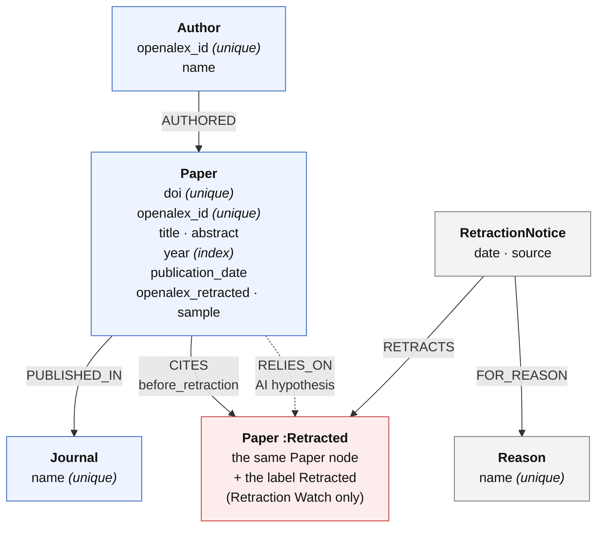
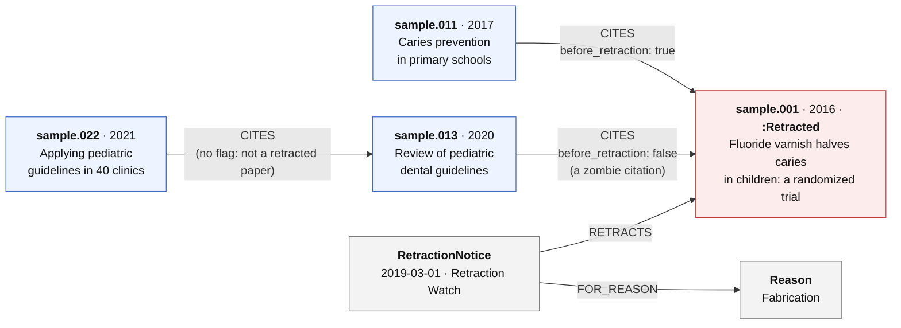

# Graph model

*Person 2 (Data). The loader that builds this graph is `scripts/ingest.py`.*

## Schema

A PNG of the same diagram is in [`graph_schema.png`](graph_schema.png) (for slides).

| Node | What it is | Key properties |
| --- | --- | --- |
| `Paper` | A paper from OpenAlex: a retracted paper or a paper that cites one | `doi`, `openalex_id` (both unique), `title`, `year`, `publication_date`, `abstract` |
| `:Retracted` | Extra label on a `Paper` that Retraction Watch lists as retracted | (none, it is a label) |
| `RetractionNotice` | One source saying that a paper is retracted | `date`, `source` (`Retraction Watch` or `OpenAlex`) |
| `Reason` | A retraction reason from Retraction Watch, e.g. "Concerns/Issues about Data" | `name` (unique) |
| `Author` | An OpenAlex author | `openalex_id` (unique), `name` |
| `Journal` | Where a paper was published | `name` (unique) |

| Relationship | Meaning | Properties |
| --- | --- | --- |
| `(:Paper)-[:CITES]->(:Paper)` | the first paper lists the second one in its references (fact from OpenAlex) | `before_retraction` on every citation to a retracted paper |
| `(:RetractionNotice)-[:RETRACTS]->(:Paper)` | this notice withdraws this paper | |
| `(:RetractionNotice)-[:FOR_REASON]->(:Reason)` | this notice gives this reason | |
| `(:Author)-[:AUTHORED]->(:Paper)` | authorship | |
| `(:Paper)-[:PUBLISHED_IN]->(:Journal)` | where it was published | |
| `(:Paper)-[:RELIES_ON]->(:Paper:Retracted)` | the citing paper *probably* depends on the retracted one (AI judgement, Person 3) | `confidence`, `evidence`, `verdict`, `model`, `judged_at`, `source = 'llm'` |

Two extra properties on `Paper`: `openalex_retracted` (OpenAlex's own retraction flag on the citing papers, see
decision 3) and `sample = true` on the 20 hand-made papers of `data/sample/`.

**Constraints and indexes.** Unique constraints on `Paper.doi`, `Paper.openalex_id`, `Author.openalex_id`,
`Journal.name` and `Reason.name` (each one also creates an index), plus a range index on `Paper.year`.
All of them are created by the loader before any data, so running it twice never creates duplicates.

**Size** (local database after loading, real data + the 20 sample papers): 9,354 papers, 456 of them
`:Retracted`, 908 notices, 76 reasons, 31,206 authors, 2,406 journals, 10,156 `CITES` links.

### Example on the sample graph

`sample.011` cited the trial before its retraction, `sample.013` after it (a zombie citation), and `sample.022`
is reached in two steps through `sample.013`: that is what the contamination endpoint follows.

## Why we modeled the graph this way

Each choice below answers one question the app has to answer. The numbers come from our real data
(453 retracted dental papers from Retraction Watch and the 8,881 papers that cite them, from OpenAlex).

**1. "Retracted" is a label on `Paper`, not a separate node type and not a boolean property.**
A retracted paper is still a paper: it is cited, it has authors and a journal, and it can cite other retracted
papers (106 such links in our data). A separate `RetractedPaper` node would split one paper in two. A label is
better than a property because Neo4j keeps a list of the nodes of each label, so queries can *start* from the
retracted papers. Our PROFILE benchmark (`docs/index_benchmark.md`) shows it: even without the DOI index, the
contamination query only scans the 456 `:Retracted` papers instead of all 9,354 papers.

**2. Retractions are `RetractionNotice` nodes with a `source`, not a date on the paper.**
Two sources say a paper is retracted, and they do not always agree. Retraction Watch gives a date and reasons;
OpenAlex only gives a yes/no flag. Keeping one notice per source (453 from Retraction Watch, 451 from OpenAlex)
keeps who said what. When they disagree, Retraction Watch wins, because researchers have shown that the
OpenAlex flag has errors.

**3. Only Retraction Watch gives the `:Retracted` label; OpenAlex's flag on the citing papers is kept as a property.**
OpenAlex flags 208 of the citing papers as retracted, but we have no Retraction Watch notice for them (so no date
and no reasons). Labelling them would break the rule "every retracted paper has a dated notice", and
`before_retraction` could not be computed for their citers. So they stay plain papers, with
`openalex_retracted = true`, and the information is not lost.

**4. Reasons are nodes, not a text field.**
351 of the 453 Retraction Watch notices give two reasons or more (up to 11). As nodes, "how many retractions
for fabrication?" is a simple count over `FOR_REASON` links. As one text field, every query would have to split
and clean strings.

**5. `before_retraction` is stored on the `CITES` link, computed once by the loader.**
The zombie-citation question (who keeps citing a paper after it was retracted?) needs a date comparison for each
citation. Doing it once at loading time means the queries only compare a boolean. The rule is written once:
full dates are compared when both are known, a citation in the same year counts as *before*, and an unknown date
also counts as *before*, so we only call a citation a zombie when we are sure. The loader ends with a check that
no citation to a retracted paper is missing the flag. Result: 4,861 of our 10,139 citations to retracted papers
came after the retraction.

**6. `RELIES_ON` is a separate relationship, never mixed with `CITES`.**
`CITES` is a fact from the data. Whether a paper really *depends* on a retracted result is an AI guess.
Keeping it on its own relationship, with its confidence, the sentence it is based on and the model name, means
that fact-only queries never see it by accident, and the app can always say which part is a hypothesis.
It is only created when a `CITES` link already exists, so the AI can never invent a connection.

**7. Papers and authors are identified by OpenAlex ids, not by names.**
In our data, 403 author names are shared by 926 different OpenAlex authors (for example 6 different "Yang Liu").
Merging authors by name would glue different people together. Papers are keyed by DOI *and* by OpenAlex id,
because 379 of the citing papers have no DOI.

**8. Only the relationships the questions need.**
We load the citations *to* retracted papers, not every reference of every citing paper. This keeps the graph
small (9,354 papers) and fast, and it is enough for contamination, exposure and zombie citations. The cost: the
graph does not contain citations between two non-retracted papers, so the contamination depth mainly shows
chains that go through another retracted paper.

## Comparison with a basic AI-generated schema

To check that our model is more than the obvious answer, we asked an AI assistant for a schema with only this
one-line prompt, without our data or our questions:

> Design a Neo4j graph schema for a project that tracks retracted scientific papers and the papers that cite them.
> List the node labels, relationship types and properties.

Its answer, summarised:

- Nodes: `Paper {id, doi, title, year, abstract, isRetracted, retractionDate, retractionReason}`,
  `Author {name, affiliation}`, `Journal {name, issn}`, `Keyword {name}`
- Relationships: `(:Author)-[:WROTE]->(:Paper)`, `(:Paper)-[:PUBLISHED_IN]->(:Journal)`,
  `(:Paper)-[:CITES]->(:Paper)`, `(:Paper)-[:HAS_KEYWORD]->(:Keyword)`
- An index on `Paper.doi`

It is a reasonable start, and it gets the core right: papers, authors, journals and a `CITES` relationship.
Here is what goes wrong with our data and our questions:

| Basic schema | What happens with our data | Our model |
| --- | --- | --- |
| `isRetracted` boolean on `Paper` | Every "start from the retracted papers" query reads all 9,354 papers and filters them | `:Retracted` label: the planner scans only the 456 retracted papers |
| `retractionDate` and `retractionReason` on `Paper` | Only one source fits: no room for OpenAlex's flag next to Retraction Watch, nor for their disagreements | `RetractionNotice` with `source`, one per source |
| `retractionReason` as one string | 351 notices have 2 to 11 reasons, so counting by reason means splitting strings in every query | `Reason` nodes and `FOR_REASON` links |
| `CITES` without properties | The zombie-citation question compares dates on every request, and each query must repeat the same-year / unknown-date rules | `before_retraction` computed once, with one written rule and a final check |
| Nothing for "relies on" | Adding it later as a property of `CITES` would mix AI guesses with facts | `RELIES_ON` kept apart, with confidence and evidence |
| `Author` identified by `name` | 926 different authors would collapse into 403 names | `Author.openalex_id`, unique |
| `Paper.id` / DOI as the only key | 379 citing papers have no DOI | both `doi` and `openalex_id` are unique keys |
| No constraints | Nothing stops two `Paper` nodes with the same DOI, or two copies of the same journal | 5 unique constraints + a year index, created before the data |

Two ideas of the basic schema are fair and we chose not to use them: `Keyword` nodes (the research field) and
`Journal.issn`. We left keywords out because the communities of the citation graph (Louvain, Person 1) already
group papers by topic, and all our papers come from one field (dentistry). An ISSN would be a better journal key
than the name, but our cached data only keeps the journal name, so we kept the name for now.

## Limits

- Citations between two non-retracted papers are not loaded (decision 8).
- Citing papers have no abstract in the graph; the audit agent fetches it from OpenAlex when it needs it.
- 4 of the 457 selected Retraction Watch papers are not in OpenAlex, so they are not in the graph.
